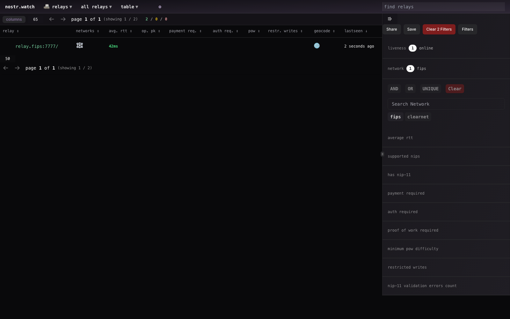
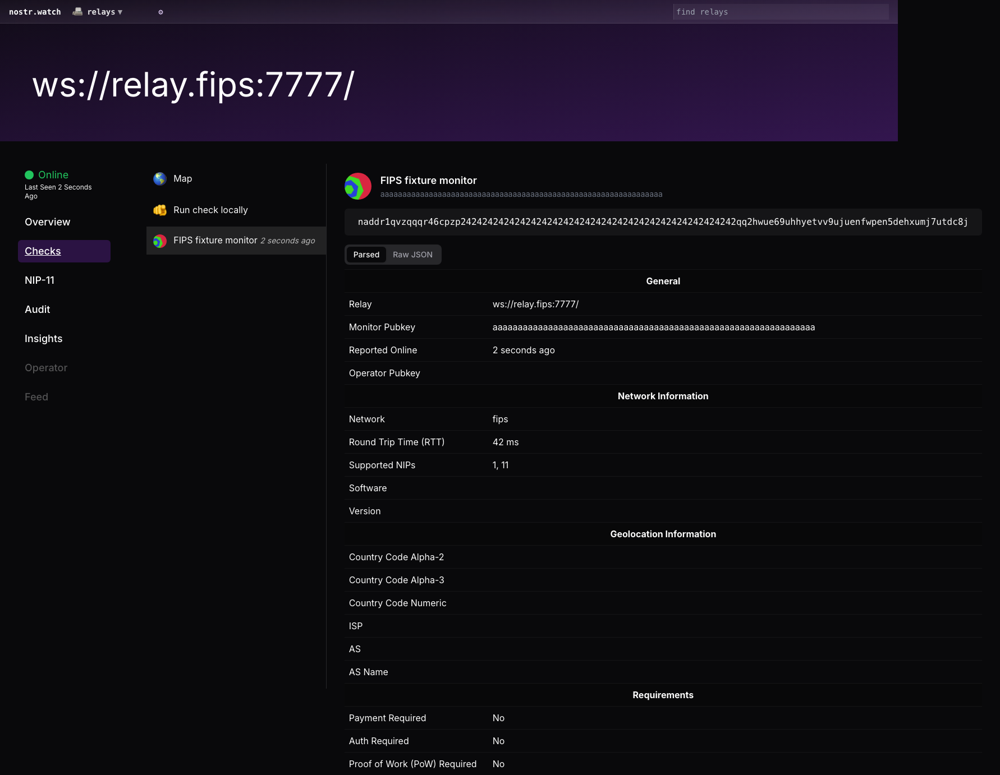
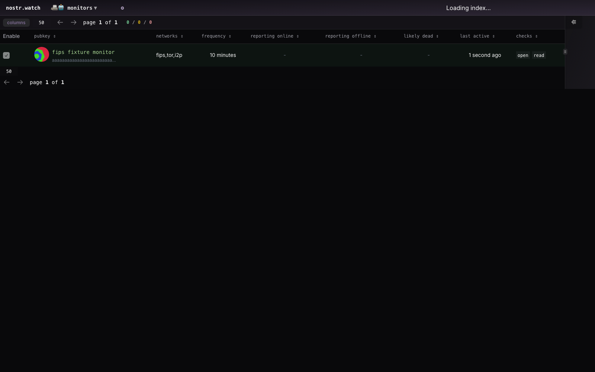

# FIPS network support

## Overview

nostr.watch recognizes relay URLs ending in `.fips` as the
[Free Internetworking Peering System](https://fips.network/) network. It supports discovery, Relaymon monitoring, NIP-66
announcements and observations, trusted relay assertions, rstate queries, and
GUI relay and monitor views. This is network support, not FIPS cryptographic
module certification.

## Host prerequisites

The monitor process must already resolve `.fips` names and route IPv6 traffic to
the mesh. Relaymon uses ordinary WebSocket and HTTP connections, like its I2P
integration. It does not start FIPS, manage identities, install routes, expose
services, or require a FIPS-specific proxy.

For a container deployment, verify DNS and IPv6 routing from the monitor's own
network namespace. Host connectivity alone does not establish container
connectivity. Existing Tor routing must continue to apply only to Tor traffic;
FIPS destinations must reach the host-provided mesh route.

Enable the network explicitly:

```yaml
relaymon:
  networks:
    - clearnet
    - tor
    - i2p
    - fips
  seed:
    sources: [config]
    options:
      config:
        - ws://<npub>.fips:7777
```

Merge these fields into a complete monitor configuration. Human-readable local
FIPS aliases also work when the monitor's resolver knows them. Use the full
`<npub>.fips` address when sharing a relay URL across hosts. Ports, paths,
uppercase hostnames, and a trailing DNS root dot are supported.

FIPS names are not sent to public DNS-over-HTTPS or geolocation services. DNS
checks report that public lookup is skipped; this does not prevent the OS from
resolving the name for WebSocket and NIP-11 connections. FIPS does not imply
anonymity. Trusted assertions preserve `network=fips` without Tor/I2P privacy
bonuses or a fabricated anonymous country code. Arbitrary `fd00::/8` addresses
remain unclassified because that range is shared with other private networks.

The fisherman deployment and its private Ansible configuration are outside
this repository's changes.

## Consumer behavior

- Trawler accepts npub-based `.fips` hostnames in relay-list events and records
  them as `network=fips`. Only the hostname is exempt from npub rejection;
  npub paths, other URL components, and non-FIPS hostnames remain blocked.
  Initial FIPS seeds require `trawler.seed.options.allowedNetworks` to include
  `fips`. See [Trawler configuration](../apps/trawler/README.md#fips-discovery).
- Kind 10166 advertises `['n', 'fips']`; kind 30166 preserves the same network
  tag and the `.fips` relay URL. Kind 1066 continues to identify the relay with
  its `r` tag. Kind 30385 preserves FIPS as its network.
- rstate normalizes FIPS observations, aggregates and groups them separately,
  and accepts `network: 'fips'` in REST/CVM searches and subscription schemas.
- GUI network filters use observed FIPS values. Relay rows display a mesh icon
  named **FIPS** for assistive technology. Monitor rows include FIPS alongside
  their other advertised networks. Relay detail routes preserve `.fips` URLs.

## Secure live fixture

The opt-in fixture uses two ephemeral containers on an internal Docker network.
It creates new identities for each run, disables public and LAN discovery,
publishes no ports, never uses host networking, and mounts only generated
configuration files. Both containers have read-only filesystems, dropped
capabilities, disabled privilege escalation, resource limits, and default-deny
IPv4/IPv6 firewall policies. Only the configured peer's UDP transport is allowed
on the Docker interface. Only the fixture relay's TCP port 7777 accepts mesh
ingress. A wildcard-bound sentinel on the monitor's port 7778 must remain
unreachable, with packet drops verified on the monitor's ingress rule.

Build an upstream [FIPS](https://github.com/jmcorgan/fips) test image for your
architecture containing `/usr/local/bin/fips`, then run from this repository:

```sh
docker build --build-arg FIPS_IMAGE=<local-fips-image> \
  -t nostr-watch-fips-fixture:local \
  -f apps/relaymon/tests/fixtures/fips/Dockerfile .
python3 apps/relaymon/tests/fixtures/fips/run.py \
  --output /tmp/nostr-watch-fips-proof.json
```

Dependencies are downloaded during the image build. Runtime checks use cached
dependencies and cannot reach the public Internet. The runner requires Docker,
Python 3, Node, and installed repository dependencies. It removes its containers,
network, and private temporary configuration on exit. The proof JSON includes a
signed observation and public results; no private identities are retained.

The fixture now monitors a full npub-based hostname and runs Trawler's actual
entrypoint. Starting from an alias seed, Trawler receives a signed kind-10002
advertisement, persists the npub URL as FIPS, and crawls that address on a
subsequent queue cycle. Invalid npub paths and suffix lookalikes must not enter
the database. The [discovery report](proofs/fips/discovery.md) records this proof.

## Verification

The implementation audit and unit/regression strategy are recorded in
[the implementation plan](../.memory/plans/fips-support.md). Verification covers
both URL classifiers, seeding and DB partitioning, direct transport, DNS privacy,
monitor validation and publishing, rstate normalization/querying, Chronicle,
GUI formatting, and browser rendering/filtering.

See the [verification report](proofs/fips/verification.md),
[live monitor proof](proofs/fips/monitor.json), and GUI proofs:






